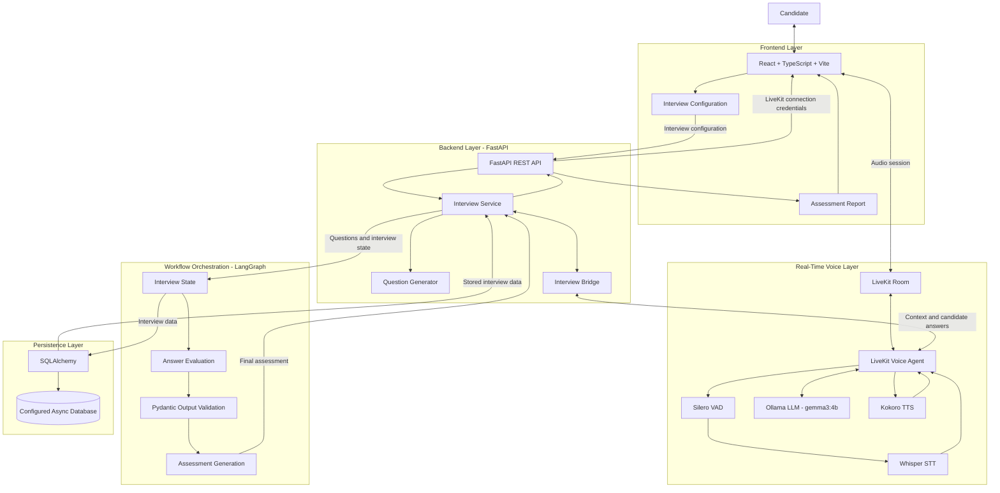

# AI Interview Platform
### Real-Time Voice Interview & Assessment Platform

An AI-powered technical interview platform designed to conduct real-time voice interviews, generate role-specific questions, evaluate candidate answers, and produce structured assessment reports.

**Project Status:** Active Development  
**Purpose:** AI Engineer Technical Project Assignment

---

## Overview

The platform combines a FastAPI, LangGraph, and Pydantic backend with a LiveKit voice agent to provide an interactive technical interview experience.

It accepts a candidate profile, job description, required skills, and interview difficulty. It generates technical questions, conducts a spoken interview, asks contextual follow-up questions when clarification is needed, evaluates candidate responses, and makes the assessment available for review.

## Key Features

- **Real-Time Voice Interview:** Two-way voice interaction through LiveKit.
- **Speech Pipeline:** Local Whisper speech-to-text, Silero voice activity detection, and Kokoro text-to-speech integrations.
- **Role-Specific Question Generation:** Uses candidate profile, job description, required skills, and difficulty.
- **Adaptive Conversation:** Presents one question at a time and asks contextual follow-up questions when useful.
- **Conversation Controls:** Repeat, clarify, skip, attempt, and end interview.
- **AI Answer Evaluation:** Scores technical correctness, conceptual understanding, and completeness on a 0–5 scale.
- **Evidence-Based Feedback:** Identifies strengths, weaknesses, missing concepts, incorrect claims, answer evidence, and suggested improvements.
- **Assessment Reports:** Provides overall and skill-wise results, knowledge gaps, and learning recommendations.

## System Architecture

The following diagram illustrates the architecture and interaction between the frontend, backend, real-time voice processing, AI workflow, evaluation engine, and database.



### Component Responsibilities

| Component | Responsibility |
|---|---|
| React + TypeScript | Interview configuration and report interface |
| FastAPI | API endpoints and backend coordination |
| LiveKit | Real-time audio communication |
| Silero VAD | Voice activity detection |
| Whisper STT | Speech-to-text conversion |
| Ollama | Local LLM inference |
| Kokoro TTS | Text-to-speech conversion |
| Interview Bridge | Communication between voice agent and interview backend |
| LangGraph | Interview workflow orchestration |
| Answer Evaluation | Candidate answer scoring and feedback |
| Pydantic | Structured data validation |
| SQLAlchemy | Database operations and persistence |
| Database | Interview state and assessment data storage |
## Technology Stack

| Layer | Technology |
|---|---|
| Frontend | React, TypeScript, Vite |
| Backend API | Python, FastAPI |
| Real-Time Voice | LiveKit Agents |
| Speech-to-Text | Local Whisper integration |
| Voice Activity Detection | Silero VAD |
| Text-to-Speech | Local Kokoro integration |
| LLM Runtime | Ollama |
| Voice-Agent Model | `gemma3:4b` |
| Workflow Orchestration | LangGraph |
| Data Validation | Pydantic |
| Persistence | SQLAlchemy with configured async database |
| Testing | pytest |

## How It Works

1. The user configures an interview with a job description, candidate profile, skills, difficulty, and question count.
2. The frontend sends the configuration to FastAPI.
3. The interview service generates questions and initializes interview state.
4. The frontend obtains LiveKit credentials and joins the interview room.
5. The LiveKit agent retrieves interview context and greets the candidate.
6. Candidate speech is transcribed and processed as a conversational turn.
7. The agent may ask a contextual follow-up and accumulates the main answer with follow-up responses.
8. The answer is submitted to the backend evaluation workflow.
9. The interview advances to the next question or completes.
10. The frontend retrieves and presents the assessment report.

## Getting Started

### Prerequisites

Make sure you have the following installed:

- Python 3.11
- Node.js and npm
- Ollama
- LiveKit credentials and required environment configuration

### 1. Install the Voice-Agent Model

```bash
ollama pull gemma3:4b
```

### 2. Clone the Repository

```bash
git clone https://github.com/Rutuvik/AI_Interview_Agent.git

cd AI_Interview_Agent
```

### 3. Set Up the Backend

```bash
cd backend

python3.11 -m venv ivenv

source ivenv/bin/activate

pip install -r requirements.txt
```

### 4. Start the FastAPI Backend

```bash
uvicorn app.main:app --reload
```

### 5. Start the LiveKit Agent

Open another terminal:

```bash
cd backend

source ivenv/bin/activate

python -m py_compile backend/app/agents/voice_agent.py
```

### 6. Start the Frontend

Open another terminal:

```bash
cd frontend

npm install

npm run dev
```

**Note:** Configure the required environment variables and LiveKit credentials before running the complete application. Refer to the relevant configuration files for the required settings.

## Known Limitations

This project is under active development.

- Voice quality and response latency depend on local hardware, model size, and runtime configuration.
- Local LLM inference may contend for CPU/GPU and memory resources.
- AI-generated scores can differ from human judgments; benchmark results are needed to quantify agreement.
- Interview recovery, text fallback, and failure handling must be tested before being described as production ready.
- The recorded backend test baseline is below the assignment's minimum of 20 tests until additional tests are added.

## Future Updates

1. **Evaluation:** Build a 20-scenario benchmark and compare AI scores against human-reviewed reference scores.
2. **Testing & Reliability:** Expand automated tests, validate model outputs, test failure scenarios, and measure latency.
3. **Interview Experience:** Improve adaptive follow-ups, interruption handling, text fallback, and interview recovery.
4. **Assessment Reports:** Add sample reports, report exports, and detailed skill-wise evaluation.
5. **Engineering & Deployment:** Add CI/CD, deployment documentation, database backup guidance, and stronger security practices.

---

## Author

**Rutvik Chavhan**

GitHub: [Rutuvik](https://github.com/Rutuvik)
